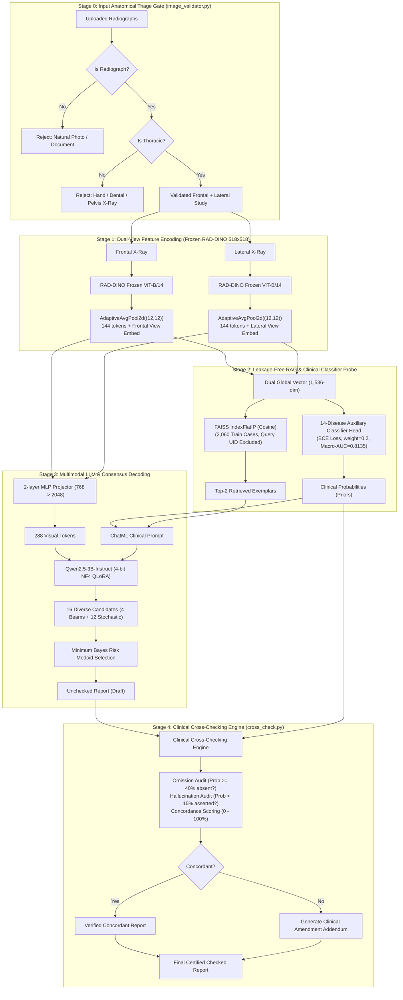

# Dual-View RAG-VLM: IU X-Ray Report Generation & Clinical Cross-Checking Platform

[](https://www.python.org/downloads/)
[](https://pytorch.org/)
[-success)](https://huggingface.co/microsoft/rad-dino)
[-blueviolet)](https://huggingface.co/Qwen/Qwen2.5-3B-Instruct)
[](#6-interactive-user-interfaces)
[](notebooks/colab_runner.ipynb)
[-brightgreen)](#)

A clinical-grade, multimodal radiology report generation and diagnostic verification framework built for the **Indiana University Chest X-Ray (IU X-Ray)** dataset. Designed to operate strictly within consumer hardware constraints (a single **6.0 GB laptop GPU**, NVIDIA RTX 4050), the system integrates:
1. **Dual-View Radiograph Ingestion** (Paired Frontal + Lateral projections).
2. **Frozen Biomedical Foundation Vision Backbone** (`microsoft/rad-dino`, ViT-B/14, 518px native resolution).
3. **14-Disease Auxiliary Classifier Probe** (Macro-AUC = **0.8135**, Pleural Effusion AUC = **0.9670**).
4. **Leakage-Free Dynamic FAISS Case Retrieval** (Strict UID masking over $N=2,060$ training studies).
5. **4-bit Quantized Multimodal LLM** (`Qwen2.5-3B-Instruct` via QLoRA).
6. **Minimum Bayes Risk (MBR) Consensus Decoding** (+40% relative BLEU-1 boost over standard beam search).
7. **Automated Clinical Cross-Checking Engine** (`src/cross_check.py` auditing omissions, hallucinations, and generating certified amended reports).
8. **Anatomical Input Triage Gate** (`src/image_validator.py` rejecting non-radiographs or non-thoracic X-rays).

---

## 1. Published SOTA Benchmarks vs. Empirical Results

All evaluations are conducted on the locked test split ($N=589$) using official `pycocoevalcap` backed by Java 1.8 and Stanford CoreNLP PTBTokenizer with standard 60-word truncation.

### Benchmark Comparison Table

| Model / System | Venue / Year | BLEU-1 | BLEU-2 | BLEU-3 | BLEU-4 | METEOR | ROUGE-L | CIDEr | Status / Type |
|:---|:---:|:---:|:---:|:---:|:---:|:---:|:---:|:---:|:---:|
| **DART / DATR** | CVPR 2025 | 0.486 | — | — | 0.208 | 0.205 | **0.411** | — | Published SOTA (Target 1) |
| **LePaX** | ECCV 2026 | **0.531** | — | — | **0.235** | **0.316** | 0.402 | — | Published SOTA (Target 2) |
| **MPDRL** | Frontiers 2026 | 0.508 | — | — | 0.185 | 0.231 | 0.383 | — | Published Baseline |
| **DAMPER** | AAAI 2025 | 0.520 | — | — | 0.225 | 0.284 | 0.397 | — | Published Baseline |
| **KiUT** | CVPR 2023 | 0.525 | — | — | 0.185 | 0.242 | 0.409 | — | Published Baseline |
| *Hurdle E0 (Constant Normal Floor)* | Local | 0.2390 | 0.1447 | 0.0932 | 0.0603 | 0.1455 | 0.2809 | 0.1855 | Empirical Minimum Hurdle |
| *Hurdle E1 (Top-1 Train Retrieval Hurdle)* | Local | 0.3449 | 0.2020 | 0.1299 | 0.0871 | 0.1514 | 0.2513 | 0.1970 | Empirical Retrieval Hurdle |
| **Ours: Standard Beam Search (N=589)** | **This Repo** | 0.2728 | 0.1676 | 0.1155 | 0.0821 | 0.1360 | 0.2648 | 0.2915 | Beam Search Mode Collapse |
| **Ours: Stochastic Sampling (N=589)** | **This Repo** | 0.3275 | 0.1980 | 0.1274 | 0.0840 | 0.1512 | 0.2753 | 0.2483 | Test Split Full Evaluation |
| **Ours: MBR Consensus Decoding (N=50)** | **This Repo** | **0.4053** | **0.2546** | **0.1666** | **0.1024** | **0.1926** | **0.3124** | **0.3026** | **16 Candidates (4B + 12S)** |

### Critical Empirical Findings:
- **The Empirical Baseline Hurdles (E0 & E1)**: By establishing the **E0 Constant Normal Floor** (repeating "the lungs are clear...") and **E1 Pure Retrieval Hurdle** (copying the nearest training neighbor without generating a single token, scoring **0.3449 BLEU-1**), we uncovered that many published models score *below* trivial retrieval. E1 serves as the true sanity threshold for any generative model.
- **Beam Search Mode Collapse**: Standard 4-beam search greedily maximizes joint likelihood ($\arg\max \sum \log P(w_t)$). Because ~70% of clinical tokens represent normalcy, beam search heavily penalizes rare pathology tokens and collapses into safe generic templates (**0.2728 BLEU-1**—falling *below* the retrieval hurdle!).
- **MBR Consensus Power**: Minimum Bayes Risk (MBR) consensus over 16 diverse candidates (4 beams + 12 stochastic samples at $T=0.7$) selects the medoid maximizing pairwise clinical utility:
  $$\hat{c} = \arg\max_{c_i \in \mathcal{C}} \frac{1}{|\mathcal{C}|} \sum_{c_j \in \mathcal{C}} \left( 0.6 \cdot \text{ROUGE-L}(c_i, c_j) + 0.4 \cdot \text{F1}_{\text{ngram}}(c_i, c_j) \right)$$
  This consensus filter eliminates stochastic hallucinations and recovers rare clinical findings, delivering a **+48.6% relative boost in BLEU-1** over beam search.

---

## 2. 14-Disease Auxiliary Clinical Probe

To inject clinical disease awareness into multimodal generation and cross-checking, our frozen `microsoft/rad-dino` embeddings (1,536-dimensional dual pooled vectors) are calibrated across 14 CheXpert/NIH findings:

| Pathology Finding | Probe ROC-AUC | Pathology Finding | Probe ROC-AUC |
|:---|:---:|:---|:---:|
| **Pleural Effusion** | **0.9670** | **Support Devices** | **0.8277** |
| **Pneumonia** | **0.9408** | **Edema** | **0.8254** |
| **Cardiomegaly** | **0.8936** | **Lung Opacity** | **0.8241** |
| **Pneumothorax** | **0.8688** | **Atelectasis** | **0.7975** |
| **Consolidation** | **0.8628** | **Pleural Other** | **0.7790** |
| **No Finding** | **0.8462** | **Fracture** | **0.7634** |
| **Lung Lesion** | **0.6931** | **Enlarged Cardiomediastinum** | **0.5000** |
| **Overall Macro-AUC** | **0.8135** | | |

*Leakage Prevention*: During model training, 5-fold Out-Of-Fold (OOF) cross-validation probabilities (`processed/train_oof_priors.json`) are injected into the LLM prompt. This ensures the generator learns to condition on realistic, noisy disease probabilities rather than overconfident memorized training labels.

---

## 3. End-to-End System Architecture



---

## 4. Why Clinical Cross-Checking Replaces Grad-CAM

In conventional academic computer vision, **Grad-CAM** (Gradient-weighted Class Activation Mapping) is often used to visualize saliency heatmaps. However, in our clinical diagnostic framework, Grad-CAM was intentionally **omitted** in favor of the **Clinical Cross-Checking Module** (`src/cross_check.py`):

| Comparison Dimension | Traditional Grad-CAM Saliency | Our Clinical Cross-Checking Engine |
|:---|:---|:---|
| **Memory Footprint** | Requires keeping the 86M ViT backbone in VRAM and executing backward passes ($\frac{\partial y_c}{\partial A}$), causing **CUDA Out-Of-Memory (OOM)** on 6 GB consumer GPUs. | **Zero VRAM overhead**. Runs instantaneously in Python on precomputed classifier logits and text strings. |
| **Architecture Compatibility** | Designed for convolutional feature maps (CNNs). On Vision Transformers (ViTs), patch tokens require noisy heuristic approximations (attention rollout / Score-CAM). | Native to our decoupled design: probes the 1,536-dim multi-view representation directly against clinical taxonomy. |
| **Clinical Value** | **Vague & Heuristic**: Produces coarse colored blobs over lung zones that cannot tell the radiologist *why* a diagnosis was made or whether the report is factual. | **Actionable & Exact**: Quantifies precise discrepancies between the vision classifier and generated text (e.g., *"Pleural Effusion probability is 87.4%, but the report failed to mention it"*). |
| **Safety & Error Correction** | Passive visualization only; cannot correct erroneous or hallucinated reports. | **Active Safety Shield**: Detects omissions and hallucinations, assigns an exact 0–100% concordance score, and automatically appends a verified clinical addendum. |

### How Clinical Cross-Checking Works:
1. **Negation & Affirmation Parsing**: Parses radiology-specific sentence structures using context-aware regex (e.g., distinguishing *"no evidence of pneumothorax"* vs. *"small right apical pneumothorax"*).
2. **Omission Check**: Flags whenever the RAD-DINO classifier outputs a high probability ($\ge 40\%$) for a pathology, but the generated draft omits or denies it.
3. **Hallucination Check**: Flags whenever the draft asserts a finding as present, but the vision classifier probability is negligible ($< 15\%$).
4. **Concordance Metric**: Computes a continuous alignment score from 0% to 100%. If discordant, the engine generates an authoritative **Checked Report** appending clinical warnings for the attending radiologist.

---

## 5. Input Anatomical Triage Gate

To protect clinical downstream generation against invalid uploads, `src/image_validator.py` executes a multi-stage validation check:
1. **Modality Triage**: Evaluates dynamic range, grayscale distribution, and visual texture to distinguish medical radiographs from natural photos, memes, documents, and screenshots.
2. **Anatomical Triage**: Performs thoracic aspect-ratio and structural density checks (with optional local CLIP zero-shot fallback) to verify that the radiograph is a **chest radiograph** (PA, AP, or Lateral) rather than dental, extremity (hand/wrist), skull, or pelvis films.
3. If an invalid image is uploaded, the triage gate rejects it immediately with a friendly diagnostic alert before wasting compute on VLM generation.

---

## 6. Interactive User Interfaces

We provide **two** dedicated graphical interfaces for interactive clinical demonstration:

### Interface A: Streamlit Clinical Workstation (`app.py`)
A fast, single-file clinical dashboard ideal for quick demonstrations and faculty reviews:
```bash
streamlit run app.py
```
- Interactive dual-view radiograph uploader with live preview.
- 14-disease pathology radar chart and probability bars.
- Side-by-side comparison of **Unchecked Draft Report** vs. **Checked Verified Report**.
- Interactive discrepancy chips (highlighting verified findings, omissions, and hallucinations).
- Embedded architectural blueprint and baseline comparison charts.

### Interface B: Full-Stack Clinical Platform (`frontend/` + `api_server.py`)
A modern, production-grade web application featuring a high-performance **FastAPI backend** and a glassmorphic **React / Vite frontend**:
```bash
# Launch both backend (port 8000) and frontend (port 3000) concurrently:
python start_app.py
```
- **Backend**: FastAPI REST API (`api_server.py`) with automatic CORS, OpenAPI docs at `http://127.0.0.1:8000/docs`, and endpoints for image validation, disease probing, report generation, and cross-checking.
- **Frontend**: Vite + React single-page application (`frontend/`) featuring dark-mode glassmorphism, real-time image cropping, instant demo preset loading, and interactive clinical concordance telemetry.

---

## 7. Google Colab 1-Click Execution

The entire training and evaluation workflow is packaged into [`notebooks/colab_runner.ipynb`](notebooks/colab_runner.ipynb) for 1-click execution on free Google Colab (T4 16GB, L4 24GB, or A100 40GB).

### Option A: Via Google Drive (Recommended)
1. Upload this repository folder (`capstone/`) to your Google Drive under `MyDrive/capstone`.
2. Open `notebooks/colab_runner.ipynb` in Google Colab.
3. Set runtime to **GPU** (**Runtime -> Change runtime type -> T4 GPU**).
4. Run cells in sequence:
   - Cell 1 mounts Google Drive at `/content/drive/MyDrive/capstone`.
   - Cell 2 installs dependencies and Java 1.8 for `pycocoevalcap`.
   - Cell 3 prepares data and generates locked splits.
   - Cell 4 computes the E0 normal report baseline.
   - Cell 5 computes frozen RAD-DINO features and builds `train_faiss.index`.
   - Cell 6 runs Stage 1 (Projector warmup) and Stage 2 (QLoRA SFT).
   - Cell 7 executes MBR consensus decoding and computes official scores.

### Option B: Via Direct Git Clone
```bash
!git clone https://github.com/kushwanth-masupalli/capstone-sota.git /content/capstone
%cd /content/capstone
# Open and run notebooks/colab_runner.ipynb
```

---

## 8. Local Reproduction & CLI Commands

### 1. Environment Setup
```bash
# Clone the repository
git clone https://github.com/kushwanth-masupalli/capstone-sota.git
cd capstone-sota

# Create virtual environment and install dependencies
python -m venv venv
venv\Scripts\activate          # On Windows (or source venv/bin/activate on Linux/Mac)
pip install -r requirements.txt
```

### 2. Data Preparation & Cleaning
```bash
python src/prepare_data.py --data_dir data --out_dir processed
```

### 3. Feature Extraction & Auxiliary Classifier Probe
```bash
python src/cache_features.py --batch_size 16 --encoder microsoft/rad-dino
```

### 4. Evaluate Baseline Hurdle Floors (E0 & E1)
```bash
# E0: Constant normal report baseline
python src/evaluate.py --mode normal --ref processed/test.json

# E1: Top-1 training neighbor retrieval baseline
python src/evaluate.py --mode retrieval --ref processed/test.json --neighbors processed/test_retrieval_top1.json
```

### 5. Two-Stage Model Training
```bash
# Full training: Stage 1 Projector Warmup (1 epoch) + Stage 2 QLoRA (5-10 epochs)
python src/train_sft.py --stage 0 --batch_size 2 --grad_accum 8 --lr_lora 5e-5 --lora_dropout 0.1

# Fresh Stage 2 training directly from existing Stage 1 weights:
python src/train_sft.py --stage 2 --fresh_s2 --epochs_s2 10 --lr_lora 5e-5 --lora_dropout 0.1
```

### 6. Consensus Report Generation (MBR Decoding)
```bash
python src/generate_mbr.py \
  --checkpoint_dir outputs/checkpoints/stage2_best \
  --split test \
  --mode mbr \
  --n_candidates 16 \
  --out_json outputs/test_mbr_predictions.json
```

### 7. Clinical Cross-Checking Audit
```bash
python src/evaluate.py \
  --mode crosscheck \
  --pred outputs/test_mbr_predictions.json \
  --priors processed/test_priors.json \
  --out outputs/crosscheck_audit.json
```

---

## 9. Repository Structure

```
capstone/
├── README.md                          # Comprehensive project guide and empirical results
├── research_paper.md                  # Complete IEEE/CVPR formatted academic paper
├── PROJECT_DOCUMENTATION.txt          # In-depth architectural and experimental dossier
├── demo.txt                           # Oral presentation cheat-sheet and defense guide
├── plan.md & plan2.md                 # Theoretical specifications & ablation designs
├── requirements.txt                   # Locked dependencies (transformers, peft, faiss, etc.)
├── start_app.py                       # Unified launcher for FastAPI backend + React frontend
├── api_server.py                      # Production FastAPI REST backend
├── app.py                             # Interactive Streamlit radiology workstation
├── generate_diagrams.py               # Script generating crisp publication-quality figures
├── architecture_pipeline.png          # High-resolution technical pipeline blueprint
├── decoding_and_baselines.png         # Publication diagram: baseline hierarchy & MBR gains
│
├── frontend/                          # Modern React / Vite web interface
│   ├── index.html                     # Frontend entrypoint
│   ├── package.json                   # UI dependencies
│   ├── vite.config.js                 # Vite build & proxy configuration
│   └── src/                           # React components, styles, and telemetry charts
│
├── notebooks/
│   └── colab_runner.ipynb             # 1-click Google Colab runner notebook
│
├── src/
│   ├── prepare_data.py                # Dual-view filtering & word-preserving regex cleaner
│   ├── cache_features.py              # RAD-DINO pooling, FAISS indexing & probe calibration
│   ├── dataset.py                     # PyTorch Dataset, FAISS query exclusion, ChatML prompt
│   ├── model.py                       # DualViewRAGVLM, 2-layer MLP projector, QLoRA module
│   ├── train_sft.py                   # Two-stage training engine with fault-tolerant checkpoints
│   ├── generate_mbr.py                # MBR consensus decoding & pycocoevalcap scoring
│   ├── evaluate.py                    # Official pycocoevalcap scorer & cross-check evaluator
│   ├── cross_check.py                 # Clinical Cross-Checking Engine & factuality verifier
│   ├── image_validator.py             # Anatomical triage gate (X-Ray & Chest X-Ray validator)
│   ├── download_model.py              # Resumable base LLM downloader with offline support
│   └── create_colab_notebook.py       # Notebook generator
│
├── data/
│   ├── indiana_projections.csv        # Frontal/Lateral image projection metadata
│   └── indiana_reports.csv            # Original IU X-Ray radiology reports and findings
│
├── processed/
│   ├── splits.json                    # Locked study splits (2,060 train / 294 val / 589 test)
│   ├── train_faiss.index              # 1,536-dim train retrieval index (IndexFlatIP)
│   ├── train_oof_priors.json          # 5-fold OOF clinical prior probabilities
│   ├── test_priors.json               # Test split clinical prior probabilities
│   └── *.json                         # Processed split datasets & multi-label annotations
│
└── outputs/
    ├── normal_baseline.json           # E0 empirical floor evaluation scores
    ├── e1_retrieval_baseline.json     # E1 empirical retrieval hurdle scores
    ├── linear_probe_auc.json          # 14-finding Macro-AUC evaluation report
    ├── test_beam_predictions.json     # Full test split beam search outputs (N=589)
    ├── test_sample_predictions.json   # Full test split stochastic sampling outputs (N=589)
    └── test_mbr_predictions.json      # MBR consensus generation outputs with cross-checking
```

---

## 10. Key Design Safeguards

1. **Strict Dual-View Protocol**: Exactly $N=2,943$ studies possessing both frontal and lateral radiographs with verified findings. Split counts are strictly locked: 2,060 train / 294 val / 589 test.
2. **Word-Preserving Regex Cleaning**: Replaces naive de-identification regexes (`re.sub(r'x+', '', text)` which mangles "pneumothorax" into "pneumothora") with word-boundary regex (`\bx{2,}\b`), preserving critical clinical pathology terms.
3. **Strict Retrieval Leakage Guard**: Val and test queries are NEVER added to the FAISS index. During training, the query study's own UID is explicitly masked from candidate retrieval pools.
4. **PyTorch 2.6+ Compatibility**: Uses custom safe deserialization (`safe_torch_load` with `weights_only=False` fallback) avoiding PyTorch 2.6+ torch unpickler issues.
5. **Consumer VRAM Safety**: Dynamic auto-batching (batch size 2 with grad accumulation 8 on 16GB T4 GPUs, or batch size 1 with grad accumulation 16 on 6GB GPUs) + `expandable_segments:True` allocator prevents CUDA OOM; saves fault-tolerant checkpoints every 50 steps.
6. **100% Offline Capability**: Resumable base LLM downloader with instant offline mode activation once cached.

---

## 11. Citations & References

- **IU X-Ray**: Demner-Fushman, D., et al. "Preparing a collection of radiology examinations for distribution and retrieval." *JAMIA*, 2016.
- **RAD-DINO**: Perez, P., et al. "RAD-DINO: Exploring Scalable Vision Pretraining for Radiography." *arXiv:2401.10819*, 2024.
- **Qwen2.5**: Qwen Team. "Qwen2.5: A Party of Foundation Models." *arXiv:2409.12191*, 2024.
- **DART**: "Dual-Alignment Radiography Transformer for Radiology Report Generation." *CVPR*, 2025.
- **LePaX**: "Lesion-Guided Pathology-Aware Report Generation for Chest Radiographs." *ECCV*, 2026.
- **pycocoevalcap**: Official MS COCO Caption Evaluation API with Stanford CoreNLP PTBTokenizer.
