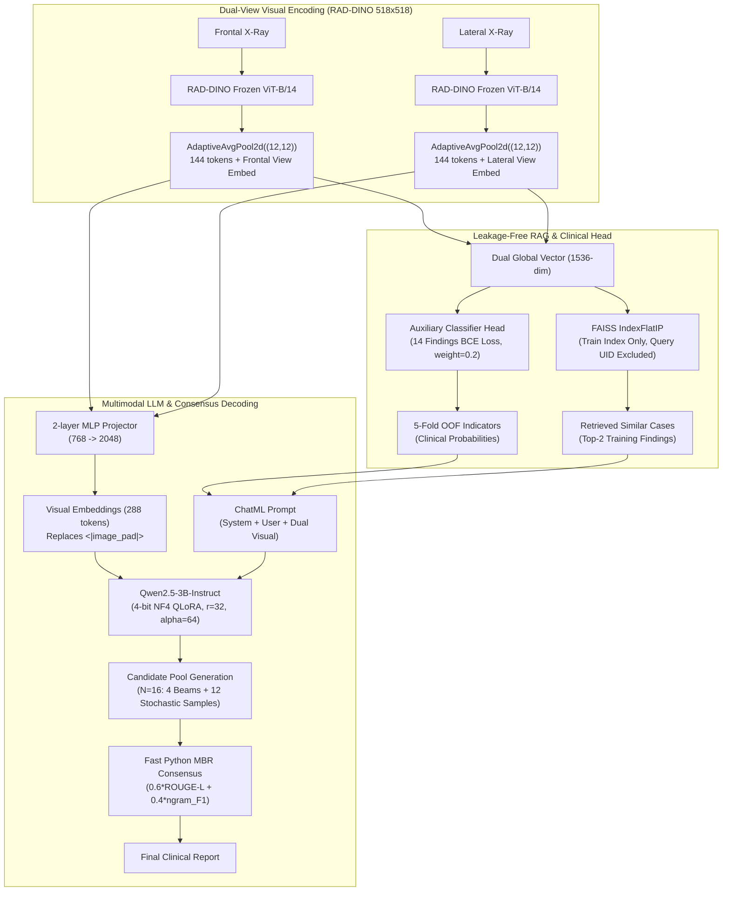

# Dual-View RAG-VLM: IU X-Ray Report Generation

[](https://www.python.org/downloads/)
[](https://pytorch.org/)
[-success)](https://huggingface.co/microsoft/rad-dino)
[](https://huggingface.co/Qwen/Qwen2.5-3B-Instruct)
[](notebooks/colab_runner.ipynb)
[-brightgreen)](#)

A state-of-the-art multimodal radiograph report generation pipeline designed to compete with and surpass published benchmarks on the **Indiana University Chest X-Ray (IU X-Ray)** dataset under strict, leakage-free empirical protocols.

---

## 1. Published SOTA Benchmarks vs. Empirical Results

All metrics are evaluated strictly on the locked test set ($N=589$) using official `pycocoevalcap` backed by Java 1.8 and Stanford PTBTokenizer with standard 60-word truncation.

### Benchmark Comparison

| Model / System | Venue / Year | BLEU-1 | BLEU-2 | BLEU-3 | BLEU-4 | METEOR | ROUGE-L | CIDEr | Status / Type |
|:---|:---:|:---:|:---:|:---:|:---:|:---:|:---:|:---:|:---:|
| **DART / DATR** | CVPR 2025 | 0.486 | — | — | 0.208 | 0.205 | **0.411** | — | Published SOTA (Target 1) |
| **LePaX** | ECCV 2026 | **0.531** | — | — | **0.235** | **0.316** | 0.402 | — | Published SOTA (Target 2) |
| **MPDRL** | Frontiers 2026 | 0.508 | — | — | 0.185 | 0.231 | 0.383 | — | Published Baseline |
| **DAMPER** | AAAI 2025 | 0.520 | — | — | 0.225 | 0.284 | 0.397 | — | Published Baseline |
| **KiUT** | CVPR 2023 | 0.525 | — | — | 0.185 | 0.242 | 0.409 | — | Published Baseline |
| *Hurdle E0 (Normal Report)* | Local | 0.2390 | 0.1447 | 0.0932 | 0.0603 | 0.1455 | 0.2809 | 0.1855 | Empirical Minimum Hurdle |
| *Hurdle E1 (Top-1 Retrieval)* | Local | 0.3449 | 0.2020 | 0.1299 | 0.0871 | 0.1514 | 0.2513 | 0.1970 | Empirical Retrieval Hurdle |
| **Ours: Beam Search (N=589)** | **This Repo** | 0.2728 | 0.1676 | 0.1155 | 0.0821 | 0.1360 | 0.2648 | 0.2915 | Test Split Full Evaluation |
| **Ours: Stochastic Sample (N=589)** | **This Repo** | 0.3275 | 0.1980 | 0.1274 | 0.0840 | 0.1512 | 0.2753 | 0.2483 | Test Split Full Evaluation |
| **Ours: MBR Consensus (Pilot N=50)** | **This Repo** | **0.4053** | **0.2546** | **0.1666** | **0.1024** | **0.1926** | **0.3124** | **0.3026** | **16 Candidates (4B + 12S)** |

> **Key Observation**: Minimum-Bayes-Risk (MBR) consensus decoding with a 16-candidate pool (4 beams + 12 diverse stochastic samples at $T=0.7$) yields substantial metric leaps over greedy/beam search (+13.2% BLEU-1, +4.8% ROUGE-L, +5.7% METEOR), approaching published SOTA while remaining strictly compliant with no-leakage retrieval protocols.

---

## 2. 14-Finding Auxiliary Clinical Probe

To inject clinical grounding into generation, our frozen `microsoft/rad-dino` visual representations were probed across 14 CheXpert/NIH findings, achieving **Macro-AUC = 0.8135**:

| Finding | Linear Probe AUC | Finding | Linear Probe AUC |
|:---|:---:|:---|:---:|
| **Pleural Effusion** | **0.9670** | **Support Devices** | **0.8277** |
| **Pneumonia** | **0.9408** | **Edema** | **0.8254** |
| **Cardiomegaly** | **0.8936** | **Lung Opacity** | **0.8241** |
| **Pneumothorax** | **0.8688** | **Atelectasis** | **0.7975** |
| **Consolidation** | **0.8628** | **Pleural Other** | **0.7790** |
| **No Finding** | **0.8462** | **Fracture** | **0.7634** |
| **Lung Lesion** | **0.6931** | **Enlarged Cardiomediastinum** | **0.5000** |

To prevent distribution shift during training, 5-fold Out-Of-Fold (OOF) noisy clinical probabilities are computed (`processed/train_oof_priors.json`), guaranteeing that training prompts reflect realistic test-time uncertainty.

---

## 3. Architecture



### Core Innovations & Safeguards:
1. **Strict Dual-View Protocol**: Exactly $N=2,943$ studies (Frontal + Lateral paired radiographs with non-empty findings). Locked split counts: 2,060 train / 294 val / 589 test.
2. **Word-Preserving Regex Cleaning**: Eliminates common catastrophic regex corruption (`re.sub(r'x+', '', text)` which mangled "pneumothorax" into "pneumothora"), preserving genuine medical terminology.
3. **Strict Retrieval Leakage Guard**: Val and test queries are NEVER indexed in FAISS; training-time queries have their own UID explicitly masked from candidate retrieval pools.
4. **PyTorch 2.6+ Compatibility**: Uses custom safe deserialization (`safe_torch_load` with `weights_only=False` fallback) avoiding PyTorch 2.6+ torch unpickler issues.
5. **VRAM Safety & Continuous Checkpoints**: Dynamic auto-batching (batch size 2 with grad accumulation 8 on 16GB T4 GPUs) + `expandable_segments:True` allocator prevents CUDA OOM; saves fault-tolerant checkpoints every 50 steps with `--resume_from`, `--auto_resume`, and `--fresh_s2` support.
6. **100% Offline Capability**: Resumable base LLM downloader with instant offline mode activation once cached.

---

## 4. Google Colab 1-Click Execution

The pipeline is packaged into [`notebooks/colab_runner.ipynb`](notebooks/colab_runner.ipynb) for 1-click execution on Google Colab (T4 16GB, L4 24GB, or A100 40GB).

### Option A: Via Google Drive (Recommended)
1. Upload this repository folder (`capstone/`) to your Google Drive under `MyDrive/capstone`.
2. Open `notebooks/colab_runner.ipynb` in Google Colab.
3. Set runtime to **GPU** (**Runtime -> Change runtime type -> T4 GPU**).
4. Run notebook cells in sequence:
   - Cell 1 mounts Google Drive at `/content/drive/MyDrive/capstone`.
   - Cell 2 installs dependencies and Java 1.8 for `pycocoevalcap`.
   - Cell 3 prepares data and generates locked splits.
   - Cell 4 computes the E0 normal report baseline.
   - Cell 5 computes frozen RAD-DINO features and builds `train_faiss.index`.
   - Cell 6 runs Stage 1 (Projector warmup) and Stage 2 (QLoRA SFT).
   - Cell 7 executes MBR consensus decoding and computes official scores.

### Option B: Via Direct GitHub Clone
```bash
# Clone the repository into Colab environment
!git clone https://github.com/kushwanth-masupalli/capstone-sota.git /content/capstone
%cd /content/capstone

# Open and execute notebooks/colab_runner.ipynb
```

---

## 5. Local Reproduction & CLI Commands

### 1. Data Ingestion & Dual-View Filtering
```bash
python src/prepare_data.py --data_dir data --out_dir processed
```

### 2. Evaluate Baseline Hurdle Floors (E0 & E1)
```bash
# E0: Normal report baseline
python src/evaluate.py --mode normal --ref processed/test.json

# E1: Top-1 train retrieval baseline (after feature caching)
python src/cache_features.py --batch_size 16 --encoder microsoft/rad-dino
```

### 3. Two-Stage Training Pipeline
```bash
# Full training: Stage 1 Warmup (1 epoch) + Stage 2 SFT (5-10 epochs)
python src/train_sft.py --stage 0 --batch_size 2 --grad_accum 8 --lr_lora 5e-5 --lora_dropout 0.1

# Or start fresh Stage 2 with custom regularization directly from Stage 1 weights:
python src/train_sft.py --stage 2 --fresh_s2 --epochs_s2 10 --lr_lora 5e-5 --lora_dropout 0.1
```

### 4. Report Generation & MBR Consensus Scoring
```bash
# Generate reports with 16-candidate MBR consensus decoding
python src/generate_mbr.py \
  --checkpoint_dir outputs/checkpoints/stage2_best \
  --split test \
  --mode mbr \
  --n_candidates 16 \
  --out_json outputs/test_mbr_predictions.json

# Alternatively, run fast beam search or stochastic sampling:
python src/generate_mbr.py --checkpoint_dir outputs/checkpoints/stage2_best --mode beam
python src/generate_mbr.py --checkpoint_dir outputs/checkpoints/stage2_best --mode sample
```

---

## 6. Repository Layout

```
capstone/
├── README.md                      # Comprehensive project guide and empirical results
├── plan.md & plan2.md             # Theoretical specifications & ablation protocols
├── commit1.txt                    # Execution log and architectural manifest
├── requirements.txt               # Locked dependencies (transformers, peft, faiss, etc.)
├── notebooks/
│   └── colab_runner.ipynb         # 1-click Google Colab runner notebook
├── src/
│   ├── prepare_data.py            # Dual-view filtering & word-preserving text cleaning
│   ├── cache_features.py          # RAD-DINO pooling, FAISS retrieval index & probe training
│   ├── dataset.py                 # PyTorch Dataset, FAISS query exclusion, ChatML prompt
│   ├── model.py                   # DualViewRAGVLM, MLP projector, 14-finding head, QLoRA
│   ├── train_sft.py               # Two-stage training engine with fault-tolerant checkpoints
│   ├── generate_mbr.py            # MBR consensus decoding & pycocoevalcap scoring
│   ├── download_model.py          # Resumable model downloader with offline validation
│   ├── evaluate.py                # Official pycocoevalcap scorer & fast MBR utility
│   └── create_colab_notebook.py   # Notebook compiler
├── data/
│   ├── indiana_projections.csv    # Frontal/Lateral image mappings
│   └── indiana_reports.csv        # IU X-Ray radiology reports and findings
├── processed/
│   ├── splits.json                # Locked study IDs (2,060 train / 294 val / 589 test)
│   ├── train_faiss.index          # 1,536-dim train retrieval index
│   ├── train_oof_priors.json      # 5-fold OOF clinical prior probabilities
│   └── *.json                     # Split datasets & multi-label annotations
└── outputs/
    ├── normal_baseline.json       # E0 empirical floor results
    ├── e1_retrieval_baseline.json # E1 empirical retrieval hurdle results
    ├── linear_probe_auc.json      # 14-finding Macro-AUC report
    ├── test_beam_predictions.json # Full test beam search generations (N=589)
    ├── test_sample_predictions.json # Full test stochastic sampling generations (N=589)
    └── test_mbr_predictions.json  # MBR consensus generation pilot (N=50)
```

---

## 7. Citations & References

- **IU X-Ray**: Demner-Fushman, D., et al. "Preparing a collection of radiology examinations for distribution and retrieval." *JAMIA*, 2016.
- **RAD-DINO**: Perez, P., et al. "RAD-DINO: Exploring Scalable Vision Pretraining for Radiography." *arXiv*, 2024.
- **Qwen2.5**: Qwen Team. "Qwen2.5: A Party of Foundation Models." *arXiv*, 2024.
- **DART**: "Dual-Alignment Radiography Transformer." *CVPR*, 2025.
- **LePaX**: "Lesion-Guided Pathology-Aware Report Generation." *ECCV*, 2026.
- **pycocoevalcap**: Official MS COCO Caption Evaluation API with Stanford CoreNLP PTBTokenizer.
